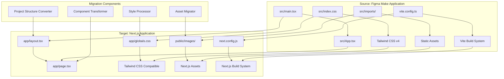

# Design Document

## Overview

This design document provides a comprehensive technical blueprint for migrating the existing Figma Make React + Vite + Tailwind CSS application to a Next.js-based architecture. The source application is a fully functional Qur'an academy website featuring complex animations, custom styling, and interactive components. This migration will preserve all existing functionality while adapting to Next.js App Router patterns and optimization features.

The migration strategy follows a component-by-component preservation approach, ensuring visual and functional parity while modernizing the build pipeline and deployment capabilities. The design addresses project structure transformation, styling system compatibility, asset optimization, and development environment configuration.

## Architecture

### High-Level Migration Architecture



### Component Architecture

The application follows a single-page application architecture with scroll-based navigation. The main App component orchestrates 11 distinct sections:

1. **Navigation (Nav)** - Fixed header with mobile drawer
2. **Hero** - Landing section with interactive parallax elements
3. **About** - Academy information and story
4. **WhyChoose** - Value proposition cards
5. **Programmes** - Course offerings grid
6. **Testimonials** - Interactive carousel with 3D effects
7. **Admission** - 7-step process visualization
8. **Fees** - Pricing information
9. **FAQ** - Collapsible question/answer accordion
10. **Registration** - Multi-field student enrollment form
11. **Contact** - Contact information and message form
12. **Footer** - Site links and branding

### State Management Architecture

The application uses React's built-in state management:

- Local component state via `useState` hooks
- Navigation coordination through callback props
- Scroll-based section navigation with smooth scrolling
- Custom `useReveal` hook for intersection-based animations

### Styling Architecture

The current styling system uses Tailwind CSS v4 with extensive customizations:

- Custom CSS variables in `@theme` block
- Islamic geometric patterns via CSS gradients
- Complex animations with CSS keyframes
- Responsive design with mobile-first approach
- Custom utility classes for specialized effects

## Components and Interfaces

### Core Components Interface

```typescript
// Navigation Interface
interface NavigationProps {
  onNav: (section: string) => void;
}

// Testimonial Data Structure
interface Testimonial {
  name: string;
  role: string;
  country: string;
  text: string;
  stars: number;
  initials: string;
  color: string;
}

// Programme Data Structure
interface Programme {
  title: string;
  level: string;
  Icon: React.ComponentType;
  accent: string;
  desc: string;
}

// Form State Interface
interface RegistrationForm {
  fullName: string;
  parentName: string;
  email: string;
  phone: string;
  country: string;
  state: string;
  gender: string;
  dob: string;
  experience: string;
  programme: string;
  days: string[];
  time: string;
  tz: string;
}
```

### Component Migration Mapping

| Source Component       | Target Location                 | Migration Notes                            |
| ---------------------- | ------------------------------- | ------------------------------------------ |
| `src/App.tsx`          | `app/page.tsx`                  | Main component becomes default page export |
| Nav component          | `components/Navigation.tsx`     | Extract to separate component file         |
| Hero component         | `components/sections/Hero.tsx`  | Preserve mouse tracking functionality      |
| About component        | `components/sections/About.tsx` | Maintain reveal animations                 |
| All section components | `components/sections/`          | Organized by feature area                  |
| Utility functions      | `lib/utils.ts`                  | Extract shared utilities                   |
| Icon system            | `components/ui/Icon.tsx`        | Centralized icon components                |
| Custom hooks           | `hooks/`                        | Extract useReveal and other hooks          |

### Asset Management Interface

```typescript
// Image Asset Structure
interface ImageAsset {
  src: string;
  alt: string;
  optimized?: boolean;
  priority?: boolean;
}

// Asset Migration Mapping
const assetMigration: Record<string, string> = {
  "src/imports/F_1.jpeg": "public/images/fikr-logo.jpeg",
  "src/imports/F_2.jpg": "public/images/hero-background.jpg",
  "src/imports/F_3.jpg": "public/images/students-class.jpg",
  "src/imports/F_4.jpg": "public/images/mission-image.jpg",
  "src/imports/F_5.jpg": "public/images/vision-image.jpg",
};
```

## Data Models

### Application Data Structure

The application uses static data arrays for content management:

```typescript
// Testimonials Data Model
const testimonials: Testimonial[] = [
  // 5 testimonial objects with complete user information
];

// Programmes Data Model
const programmes: Programme[] = [
  // 5 programme objects with icons and descriptions
];

// Why Choose Cards Data Model
const whyCards = [
  // 4 feature cards with icons and benefits
];

// FAQ Data Model
const faqs = [
  // 6 common questions with detailed answers
];

// Admission Steps Data Model
const admissionSteps = [
  // 7-step enrollment process with descriptions
];
```

### Form Data Models

```typescript
// Registration Form Schema
interface RegistrationFormData {
  personalInfo: {
    fullName: string;
    parentName?: string;
    email: string;
    phone: string;
    country: string;
    state?: string;
    gender: "Male" | "Female";
    dateOfBirth?: string;
  };
  educationalInfo: {
    experience: ExperienceLevel;
    programme: ProgrammeType;
  };
  scheduleInfo: {
    preferredDays: DayOfWeek[];
    timePreference: TimeSlot;
    timezone: TimezoneOption;
  };
}

// Contact Form Schema
interface ContactFormData {
  name: string;
  email: string;
  message: string;
}
```

### Configuration Data Model

```typescript
// Next.js Configuration Structure
interface NextJSConfig {
  experimental: {
    appDir: boolean;
  };
  images: {
    domains: string[];
    formats: ["image/webp", "image/avif"];
  };
  compiler: {
    removeConsole: boolean;
  };
}

// Tailwind Configuration Structure
interface TailwindConfig {
  content: string[];
  theme: {
    extend: {
      colors: ColorPalette;
      fontFamily: FontConfiguration;
      animation: AnimationDefinitions;
    };
  };
  plugins: TailwindPlugin[];
}
```

## Correctness Properties

_A property is a characteristic or behavior that should hold true across all valid executions of a system-essentially, a formal statement about what the system should do. Properties serve as the bridge between human-readable specifications and machine-verifiable correctness guarantees._

After reviewing the acceptance criteria through prework analysis, several core migration behaviors can be validated through property-based testing. The migration system operates on file transformations, configuration generation, and code preservation - areas well-suited for property-based verification.

### Property 1: File Transformation Preservation

_For any_ valid React entrypoint file structure (main.tsx with App component import), the migration system SHALL produce equivalent Next.js app/layout.tsx and app/page.tsx files that preserve all functionality and imports.

**Validates: Requirements 1.3**

### Property 2: Asset Relocation Completeness

_For any_ directory structure containing static assets in src/imports/, the migration system SHALL relocate ALL assets to public/images/ while maintaining correct path references throughout the codebase.

**Validates: Requirements 1.4, 4.1, 4.6**

### Property 3: Configuration Generation Correctness

_For any_ valid Vite configuration with Tailwind CSS v4 and React setup, the migration system SHALL generate corresponding Next.js and Tailwind configurations that provide equivalent functionality and build behavior.

**Validates: Requirements 1.5, 3.1, 7.3**

### Property 4: Vite Cleanup Completeness

_For any_ project containing Vite-specific files (vite.config.ts, index.html, Vite dependencies), the migration system SHALL remove ALL Vite-specific artifacts while preserving non-Vite files.

**Validates: Requirements 1.6, 7.4**

### Property 5: TypeScript Configuration Compatibility

_For any_ valid TypeScript configuration, the migration system SHALL transform it to maintain strict mode compliance while adding Next.js compatibility without breaking existing type definitions.

**Validates: Requirements 1.7, 10.3**

### Property 6: Component Behavior Preservation

_For any_ React component with props, state, hooks, and event handlers, the component converter SHALL preserve identical runtime behavior, prop interfaces, and state management after migration.

**Validates: Requirements 2.1, 2.2, 2.4**

### Property 7: Utility Function Preservation

_For any_ custom utility function or helper (useReveal, scrollTo, etc.), the migration system SHALL preserve identical function signatures, behavior, and return values in the target application.

**Validates: Requirements 2.5, 2.6, 2.7**

### Property 8: CSS Processing Preservation

_For any_ CSS pattern including custom variables, animations, keyframes, and utility classes, the style processor SHALL preserve identical visual output and behavior in the Next.js application.

**Validates: Requirements 3.2, 3.3, 3.4, 3.6**

### Property 9: Font Integration Preservation

_For any_ Google Fonts configuration and custom font definitions, the style processor SHALL maintain identical font loading, family definitions, and typography rendering.

**Validates: Requirements 3.5**

### Property 10: Image Import Transformation

_For any_ image import statement pattern in React components, the asset migrator SHALL transform imports to Next.js public path references while preserving all image properties and accessibility attributes.

**Validates: Requirements 4.2, 4.4, 4.5**

### Property 11: Navigation Behavior Preservation

_For any_ section configuration and navigation target, the navigation system SHALL preserve identical smooth scrolling behavior, section targeting, and interactive states.

**Validates: Requirements 6.1, 6.2, 6.3, 6.6**

### Property 12: Dependency Migration Correctness

_For any_ package.json with React, Vite, and Tailwind dependencies, the migration system SHALL replace ALL Vite dependencies with Next.js equivalents while maintaining compatible versions and functionality.

**Validates: Requirements 7.1, 7.2, 7.5, 7.6**

### Property 13: Code Formatting Preservation

_For any_ code formatting configuration (oxfmt, prettier, etc.), the migration system SHALL preserve equivalent formatting capabilities and code style consistency in the target application.

**Validates: Requirements 7.7, 10.4**

### Property 14: Metadata Generation Correctness

_For any_ page configuration and content structure, the build system SHALL generate appropriate Next.js metadata, SEO tags, and structured data that improves upon the source application.

**Validates: Requirements 8.4, 10.2**

### Property 15: Interactive Feature Preservation

_For any_ interactive element including animations, hover effects, form validation, and carousel functionality, the component converter SHALL preserve identical user interaction behavior and visual feedback.

**Validates: Requirements 9.1, 9.2, 9.4, 9.5, 9.6, 9.7**

### Property 16: Responsive Design Preservation

_For any_ responsive design pattern and mobile functionality, the component converter SHALL maintain identical responsive behavior across all device sizes and interaction methods.

**Validates: Requirements 9.3**

### Property 17: Component Organization Compliance

_For any_ component structure and hierarchy, the migration system SHALL organize components according to Next.js App Router conventions while maintaining logical grouping and import relationships.

**Validates: Requirements 10.1**

### Property 18: Accessibility Feature Preservation

_For any_ accessibility pattern including ARIA attributes, semantic markup, and assistive technology support, the migration system SHALL preserve identical accessibility compliance and user experience.

**Validates: Requirements 10.6**

### Property 19: Compilation Success Guarantee

_For any_ migrated codebase, the resulting Next.js application SHALL compile without TypeScript errors, ESLint violations, or build failures while maintaining equivalent performance characteristics.

**Validates: Requirements 10.7**

## Error Handling

### Migration Error Recovery

The migration system implements comprehensive error handling to ensure robust transformation:

#### File System Error Handling

- **Missing Source Files**: Graceful handling when expected source files are not found, with detailed error messages indicating missing dependencies
- **Permission Errors**: Proper handling of file system permission issues during asset copying and file creation
- **Disk Space Issues**: Detection and reporting of insufficient disk space during migration process
- **Path Resolution Failures**: Robust path resolution with fallback mechanisms for different operating system path formats

#### Configuration Error Handling

- **Invalid Vite Configuration**: Validation and error reporting for malformed or unsupported Vite configurations
- **Incompatible Dependencies**: Detection and resolution of dependency version conflicts during migration
- **Missing Required Fields**: Validation of required configuration fields with helpful error messages
- **Circular Dependencies**: Detection and resolution of circular dependency issues in component imports

#### Code Transformation Error Handling

- **Syntax Errors**: AST parsing error recovery with specific line and column error reporting
- **Type Errors**: TypeScript compatibility checking with suggested fixes for incompatible patterns
- **Import Resolution Failures**: Comprehensive import path resolution with automatic correction for common patterns
- **Component Structure Issues**: Validation of React component patterns with migration guidance for unsupported structures

#### Rollback and Recovery Mechanisms

- **Partial Migration Recovery**: Ability to rollback incomplete migrations and restore source state
- **Backup Creation**: Automatic backup creation before migration with restoration capabilities
- **Incremental Migration**: Support for step-by-step migration with rollback points at each major phase
- **Validation Checkpoints**: Comprehensive validation at each migration phase with failure recovery

### Runtime Error Handling

The migrated Next.js application maintains robust error handling:

#### Client-Side Error Boundaries

- **Component Error Boundaries**: React Error Boundary implementation for graceful component failure handling
- **Network Error Handling**: Comprehensive error handling for form submissions and external API calls
- **State Corruption Recovery**: Error recovery mechanisms for component state corruption issues
- **Navigation Error Handling**: Graceful handling of scroll navigation failures and section targeting issues

#### Development Error Handling

- **Hot Reload Error Recovery**: Proper error handling during development hot reload failures
- **Build Error Reporting**: Comprehensive build error reporting with actionable suggestions
- **Type Error Integration**: Seamless TypeScript error reporting in development environment
- **ESLint Integration**: Integrated linting error reporting with fix suggestions

#### Production Error Handling

- **Graceful Degradation**: Progressive enhancement with graceful degradation for JavaScript failures
- **Performance Monitoring**: Error tracking and performance monitoring integration points
- **User Experience Preservation**: Maintaining user experience even when non-critical features fail
- **Accessibility Fallbacks**: Ensuring accessibility features remain functional even during error conditions

## Testing Strategy

### Dual Testing Approach

The Next.js migration requires a comprehensive testing strategy combining property-based testing for migration logic with integration testing for framework behavior:

#### Property-Based Testing

**Scope**: Migration transformation logic and code preservation
**Framework**: fast-check (JavaScript/TypeScript property-based testing library)
**Configuration**: Minimum 100 iterations per property test
**Coverage Areas**:

- File transformation and preservation logic
- Configuration generation and dependency management
- Component behavior preservation across migration
- Asset relocation and path resolution
- CSS processing and styling preservation
- Code formatting and structure maintenance

**Property Test Implementation Requirements**:

- Each property test MUST reference its design document property
- Tag format: **Feature: nextjs-migration, Property {number}: {property_text}**
- Use generators for various project structures, component patterns, and configuration combinations
- Mock file system operations for consistent test execution
- Verify both successful transformations and error handling paths

#### Integration Testing

**Scope**: Next.js framework behavior and external tooling
**Coverage Areas**:

- Next.js development server functionality (Requirement 5.1, 5.2)
- TypeScript compilation and type checking (Requirement 5.3)
- ESLint integration and configuration (Requirement 5.4)
- Production build optimization (Requirement 5.5, 8.1, 8.3)
- Development experience and performance (Requirement 5.6)
- Static export functionality (Requirement 8.2)
- Deployment platform compatibility (Requirement 8.6)
- Visual regression testing (Requirement 3.7)
- SPA navigation behavior (Requirement 6.4, 6.5)
- Performance benchmarking (Requirement 8.5)

#### Example-Based Unit Testing

**Scope**: Specific migration scenarios and edge cases
**Coverage Areas**:

- Specific component migration patterns
- Known problematic Vite configuration edge cases
- Tailwind CSS v4 specific patterns requiring special handling
- Asset import edge cases and special file types
- Form validation scenarios and interactive element testing

#### Visual Regression Testing

**Scope**: Ensuring visual parity between source and target applications
**Tools**: Playwright or Puppeteer for screenshot comparison
**Coverage Areas**:

- Complete page layout comparison
- Component-level visual testing
- Responsive design verification across device sizes
- Animation and transition visual verification
- Interactive state visual comparison

#### End-to-End Testing

**Scope**: Complete migration workflow validation
**Coverage Areas**:

- Full migration pipeline execution
- Post-migration application functionality
- Development workflow verification
- Build and deployment process validation
- Performance and accessibility compliance

### Testing Infrastructure Requirements

#### Test Environment Setup

- Isolated file system environments for migration testing
- Mock Next.js and Vite CLI tools for consistent testing
- Automated test project generation for various source patterns
- Docker containers for consistent testing environments across platforms

#### Continuous Integration

- Automated testing pipeline for all migration scenarios
- Performance regression testing in CI environment
- Cross-platform migration testing (Windows, macOS, Linux)
- Dependency version matrix testing for compatibility

#### Test Data Management

- Generated test projects covering various Figma Make patterns
- Real-world project samples for integration testing
- Performance baseline data for regression detection
- Visual regression baseline image management

This comprehensive testing strategy ensures the migration system reliably transforms Figma Make applications to Next.js while preserving all functionality, performance, and user experience characteristics.
